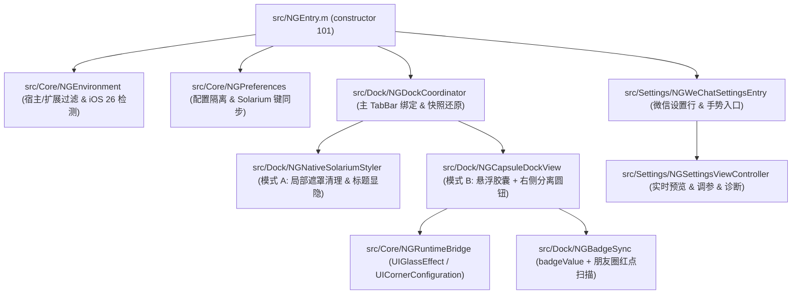

# Naloia Glass — 微信液态玻璃 Dock 栏插件设计文档

> [!IMPORTANT]
> 本项目定位于 **`.dylib` 注入签 IPA 优先**（同时附带越狱 Rootless `.deb` 产物），目标仓库为 [SOLHK/NaloiaGlass](https://github.com/SOLHK/NaloiaGlass)，本地工程目录为 `D:/Gemini/NaloiaGlass`。

## 1. 背景与目标（Intent & Why）

结合两个参考开源方案的核心长处并消除各自隐患，构建专注微信底部 Dock 栏的液态玻璃插件 **Naloia Glass**：

- **吸收 `pxx917144686/WeChat_LiquidGlass`（B 方案）**：在 `constructor` 超早期写入 `com.apple.SwiftUI.IgnoreSolariumLinkedOnCheck` 解锁 iOS 26 系统级真原生 Solarium `UITabBar` 液态玻璃（真实 GPU 折射、高光边缘、按压/拖动液态透镜物理反馈），并剥离微信底栏遮挡层。
- **吸收 `HamizDev/WeaveGlass`**：基于公开 `UITabBarController` 生命周期与运行时动态解析的 `UIGlassEffect` 构建无损热恢复的自绘悬浮胶囊 Dock，配置独立存储，内置手势唤起设置页与自动化测试构建流水线。
- **针对签 IPA 与真机体验的关键修正**：移除全局 `UIView addSubview:` 和全局 `UITabBarItem` 标题置空等高危 Hook；解决重签改包名导致插件失效、链接 `CydiaSubstrate` 导致非越狱 IPA 启动闪退、以及微信「发现/朋友圈」纯红点未读态丢失的问题。

---

## 2. 目标、非目标与反目标

### 核心目标（Goals）
1. **零越狱依赖纯原生 `.dylib`（工程默认决策）**：仅链接 iOS 公开系统框架（`UIKit`、`Foundation`、`QuartzCore`、`CoreFoundation`、`CoreGraphics`、`libobjc`），`LC_ID_DYLIB` 固定为 `@rpath/NaloiaGlass.dylib`，不依赖 `CydiaSubstrate` / `ElleKit` / `Orion`，可直接用 Feather、ESign、Sideloadly、TrollFools 等工具注入微信 IPA 重签。
2. **严格锁定微信官方包名 `com.tencent.xin`（用户已确认）**：不改包名、不做多开适配；宿主激活条件严格锁定 `[NSBundle.mainBundle.bundleIdentifier isEqualToString:@"com.tencent.xin"]` 且非 `.appex` 扩展进程，天然隔离微信 Share/Notification 等扩展与其它应用，保持原包名签名最稳妥。
3. **双模合一 Dock 引擎（用户已选定方案 1）**：
   - **模式 A：iOS 26 系统真原生模式（System Native Solarium，默认模式）**
     - 在 `__attribute__((constructor(101)))` 早期向当前应用域（`NSUserDefaults` + `CFPreferencesCurrentApplication`）同步 `com.apple.SwiftUI.IgnoreSolariumLinkedOnCheck = YES`；切离此模式或关闭插件时彻底清除该键。
     - **仅限主 `UITabBar` 子树内**定向识别并快照隐藏阻碍透光的遗留遮罩（如 `tag == 102289` 或覆盖全栏的旧式背景挡板），绝不触碰系统 `_UIBarBackground` 与原生玻璃层。
     - 可选「隐藏底栏文字标签」：仅快照并置空主 `UITabBar.items` 标题且居中图标，关闭时完整还原。
   - **模式 B：自绘悬浮胶囊模式（Floating Capsule Dock，实时热切换免重启）**
     - 运行时通过带签名的 `objc_msgSend` 动态桥接 `UIGlassEffect`（`Regular = 0` / `Clear = 1`，开启 `interactive = YES`）与 `UICornerConfiguration.capsuleConfiguration`（回退连续圆角；开启系统「降低透明度」时回退不透明系统分组背景）。
     - 快照并隐藏原生 `UITabBarButton`（自动检测 UIKit 重建按钮并重绑），透明化 `UITabBarAppearance`。
     - 挂载 `NGCapsuleDockView`：支持左右边距与高度滑块调节、弹性选中滑块（默认微信绿 `#07C160`，可自定义 `#RRGGBB`）、按压回弹缩放动效、可选点击轻触感（`UIImpactFeedbackGenerator`）、可选隐藏文字。
     - **可选右侧独立分离圆钮（工程默认决策）**：开启且标签数 ≥ 3 时，将最右侧标签（如「我」）独立为右侧圆形液态玻璃按钮，左侧其余标签组成主胶囊；点击与双击动作完整转发给宿主 `UITabBarController` 及其 `delegate`（保留双击底栏滚回未读消息等原生交互）。
     - **数字角标 + 朋友圈纯红点双通道同步**：既读取 `UITabBarItem.badgeValue`，又扫描对应原生 `UITabBarButton` 内的可见徽标/红点子视图，避免「发现」页朋友圈红点丢失。
   - **关闭状态（Disabled）**：完整恢复原生外观、按钮、标题并移除 Solarium 偏好键。
4. **双入口设置页与实时预览（工程默认决策）**：
   - 入口 1：微信「我 → 设置」首分组动态注入 `"Naloia Glass"` 入口（零编译期微信私有符号依赖）。
   - 入口 2：长按底栏 `0.8s` 或主窗口三指三击弹出 `NGSettingsViewController`，内置实时交互 Dock 预览卡片、模式与视觉开关、颜色预设、宿主层级诊断复制、JSON 配置导入导出与一键重置。
5. **跨 SDK 编译与 GitHub Actions 自动化构建（工程默认决策）**：
   - 运行时动态桥接 iOS 26 API，支持在任意 iOS 16+ / 26+ SDK 下 `-Wall -Wextra -Werror` 零警告编译。
   - GitHub Actions 自动跑通源码安全契约与 Mach-O 重签测试，产出 `NaloiaGlass-<version>-dylib.zip`（主产物，通过 `codesign --force --sign -` 重签校验）及可选 Rootless `.deb` 附产物。

### 非目标与红线（Non-Goals & Anti-Goals）
- **非目标**：不修改聊天气泡、顶栏、输入框、朋友圈列表等非 Dock 界面；不触碰微信消息、网络、登录与支付数据。
- **红线**：严禁全局 Hook `-[UIView addSubview:]` 或按 `"ExtraLight"` 字符串全局隐藏模糊层；严禁全局拦截非主底栏的 `UITabBarItem`；严禁引入 `CydiaSubstrate` 等越狱库链接依赖；严禁向宿主乱写非 `com.solhk.naloiaglass.*` 配置项。

---

## 3. 方案对比记录（Approaches）

| 方案 | 核心做法 | 权衡结论 |
| --- | --- | --- |
| **1. 双模合一（已选定）** | 原生 Solarium 解锁 + 精准局部去遮罩 + 自绘 `UIGlassEffect` 悬浮胶囊/分离圆钮 | 兼得系统级真实折射透镜与免重启高自由度定制，单 `.dylib` 适配签 IPA |
| 2. 仅系统原生解锁 | 仅写 `IgnoreSolariumLinkedOnCheck` + 去遮罩 | 无法调边距/分离按钮/清透材质，开关必重启 |
| 3. 仅自绘悬浮胶囊 | 仅挂载自定义胶囊视图覆盖 TabBar | 缺少 iOS 26 系统级拖动液态透镜物理折射 |

---

## 4. 工程目录划分（`D:/Gemini/NaloiaGlass`）

- `src/Core/`：`NGEnvironment`、`NGPreferences`、`NGRuntimeBridge`
- `src/Dock/`：`NGDockCoordinator`、`NGNativeSolariumStyler`、`NGCapsuleDockView`、`NGBadgeSync`
- `src/Settings/`：`NGWeChatSettingsEntry`、`NGSettingsViewController`
- `scripts/`：`build_dylib.sh`（纯 `clang` 产出 `@rpath/NaloiaGlass.dylib` + `.zip` + `SHA256SUMS.txt`）、`package_deb.sh`
- `tests/`：`test_source_contracts.py`、`test_macho_and_ipa_compat.py`
- `.github/workflows/build.yml`：静态检查 + macOS 编译 `.dylib`/`.zip`/`.deb` + `codesign` 二次重签校验
